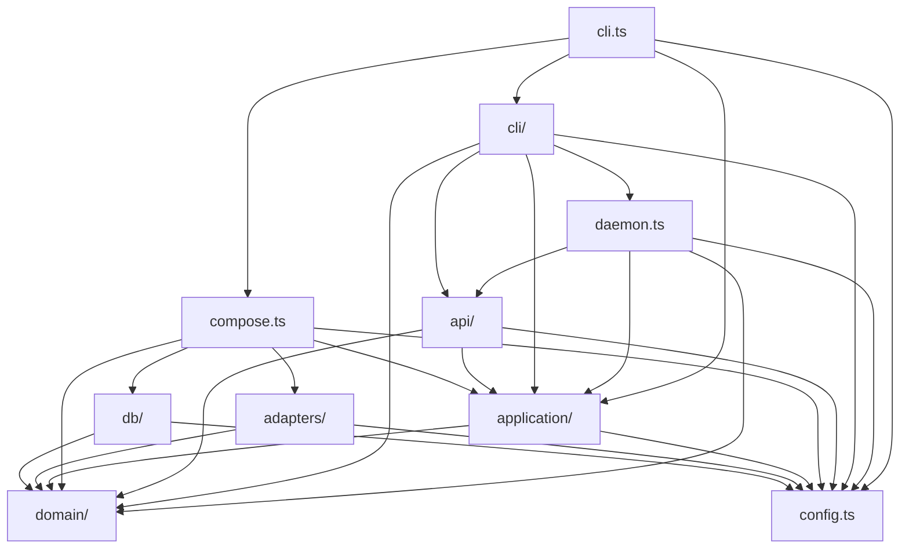
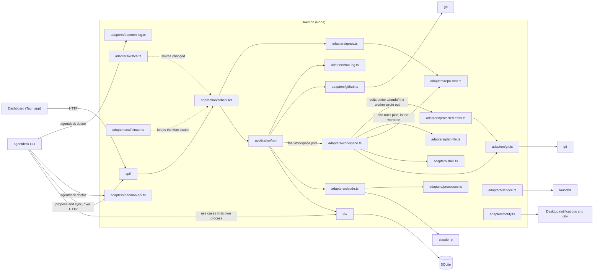
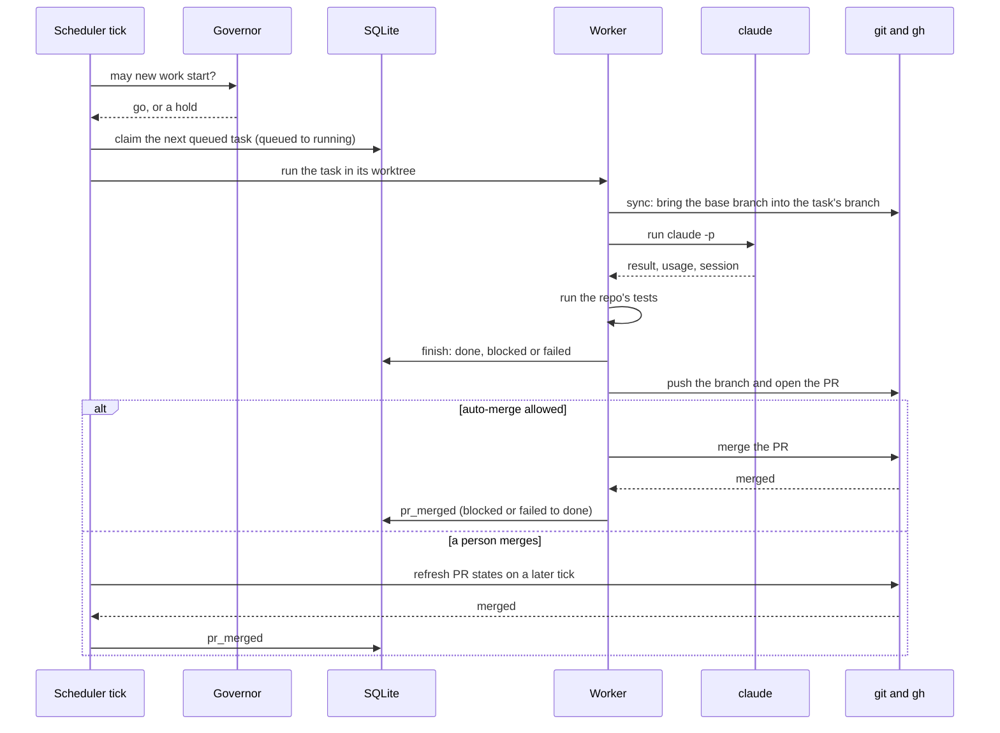

# Architecture

A map of AgentDeck's code, layers first. The block between `<!-- generated:layers -->` and `<!-- /generated -->` and every file in `docs/reference/` marked generated are written by `pnpm docs:gen` from the code (Claude's edit hook runs it after each edit under `daemon/src`), and `pnpm test` fails when they are stale. The two sections written by hand here are checked too: every file in `daemon/src/adapters/` must be named in the system context, and every identifier in backticks in them must be exported from `daemon/src`. The rules the layers follow are in CLAUDE.md. The decisions behind the design are in `docs/adr/`: [0001 worker sandbox](adr/0001-worker-sandbox.md), [0002 functional DDD](adr/0002-functional-ddd.md), [0003 one table, a rich aggregate, a flat API](adr/0003-one-table-rich-aggregate.md), [0004 `task_events` as the outbox](adr/0004-task-events-outbox.md) and [0005 a few deep ports](adr/0005-few-deep-ports.md).

## Layers

What each layer of `daemon/src` holds and may import. The rule is `LAYERS` in `daemon/scripts/lib/layers.ts`: the architecture test enforces it and this section is generated from it.

<!-- generated:layers -->

| Layer          | Holds                                                                                                             | May import                                                  | Why                                                                                                        |
| -------------- | ----------------------------------------------------------------------------------------------------------------- | ----------------------------------------------------------- | ---------------------------------------------------------------------------------------------------------- |
| `domain/`      | Entities and decisions, pure: task lifecycle, governor, prompts, plans                                            | nothing                                                     | domain/ is pure and imports no other layer                                                                 |
| `config.ts`    | Paths and constants                                                                                               | nothing                                                     | config.ts is read by every layer and imports none                                                          |
| `db/`          | Every SQL query, through Drizzle, and the migrations                                                              | `domain/`, `config.ts`                                      | db/ holds the SQL and knows only the domain                                                                |
| `adapters/`    | The I/O: claude, git, gh, processes, shell, notifications, launchd, run logs                                      | `domain/`, `config.ts`                                      | adapters import domain/ and config.ts only; they report through callbacks                                  |
| `application/` | The use cases, and the ports (repositories and other interfaces) they reach the database and the adapters through | `domain/`, `config.ts`                                      | application/ reaches the database and the adapters only through the ports it declares (application/ports/) |
| `compose.ts`   | Builds the App the use cases take, on the database and the real adapters                                          | `application/`, `adapters/`, `db/`, `domain/`, `config.ts`  | compose.ts builds the App and uses no entry point                                                          |
| `api/`         | The dashboard's HTTP API                                                                                          | `application/`, `domain/`, `config.ts`                      | entry points use application/actions.ts, domain/ and the contract; only compose.ts names db/ and adapters/ |
| `cli/`         | One file per command group of the agentdeck CLI                                                                   | `api/`, `application/`, `domain/`, `config.ts`, `daemon.ts` | entry points use application/actions.ts, domain/ and the contract; only compose.ts names db/ and adapters/ |
| `daemon.ts`    | Wires the source watcher, the API and the scheduler onto the App it is given                                      | `api/`, `application/`, `domain/`, `config.ts`              | daemon.ts gets its App from compose.ts and names neither db/ nor adapters/                                 |
| `cli.ts`       | The CLI entry point the launchd plist runs                                                                        | `cli/`, `application/`, `compose.ts`, `config.ts`           | cli.ts only dispatches to cli/                                                                             |

No import falls outside the rule.

<!-- /generated -->

## System context

## One task's run

`Scheduler` ticks, asks the governor (`decide`, behind `startGate`) whether new work may start, and claims the next queued task into a slot. `runTask` syncs the branch (`syncBranch`), runs claude through `runClaude`, then the repo's tests, and opens the pull request (`openPullRequest`). A repo with auto-merge on is merged by `autoMerge`; otherwise a person merges, and `refreshPrStates` finds the merged PR and moves the task on with the pr_merged event. How a run's plan travels and how a cut-off run resumes are in [runs](reference/runs.md).

## Reference

- [Data model](reference/data-model.md), [migrations](reference/migrations.md) and [settings](reference/settings.md): the tables and their keys, the steps of `db/schema.ts`, and each setting with its default and meaning.
- [Task lifecycle](reference/lifecycle.md): every status change and its event.
- [HTTP API](reference/routes.md): the routes and the use case each calls.
- [Adapters](reference/adapters.md) and [adapter use](reference/adapter-use.md): what each file in `daemon/src/adapters/` does, and which adapters each area of `application/` imports.
- [Context map](reference/context-map.md): the folders under `domain/` and the imports between them.
- [Models](reference/models.md), [use cases](reference/use-cases.md) and [state machines](reference/state-machines.md): the entities, `application/actions.ts` and the rule tables. [Migration progress](reference/progress.md) counts what is left of the move to a domain model.
- [Runs](reference/runs.md): plans in a run, and resuming a cut-off run.
