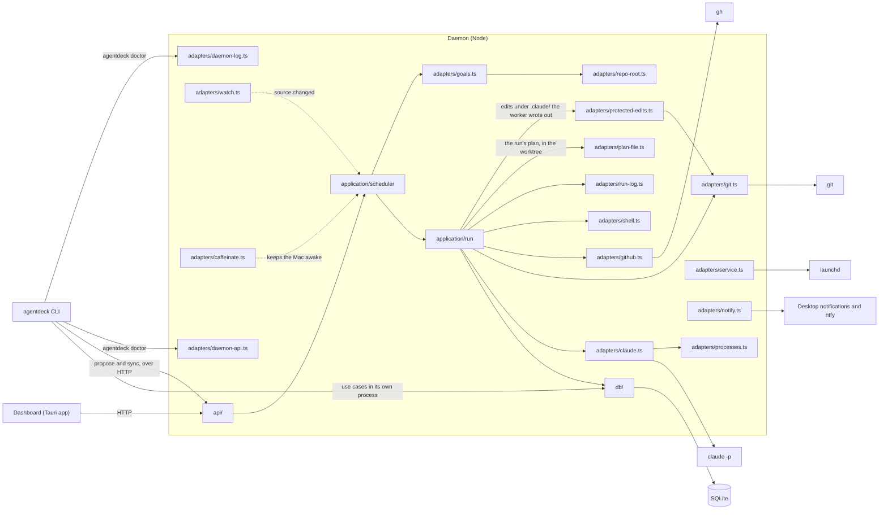
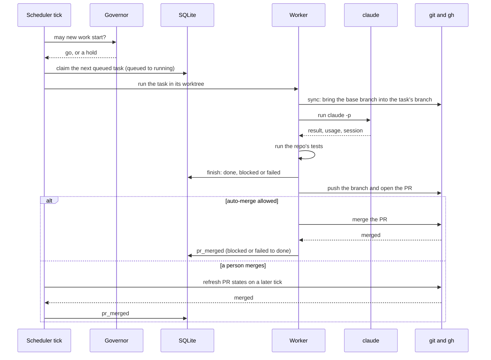
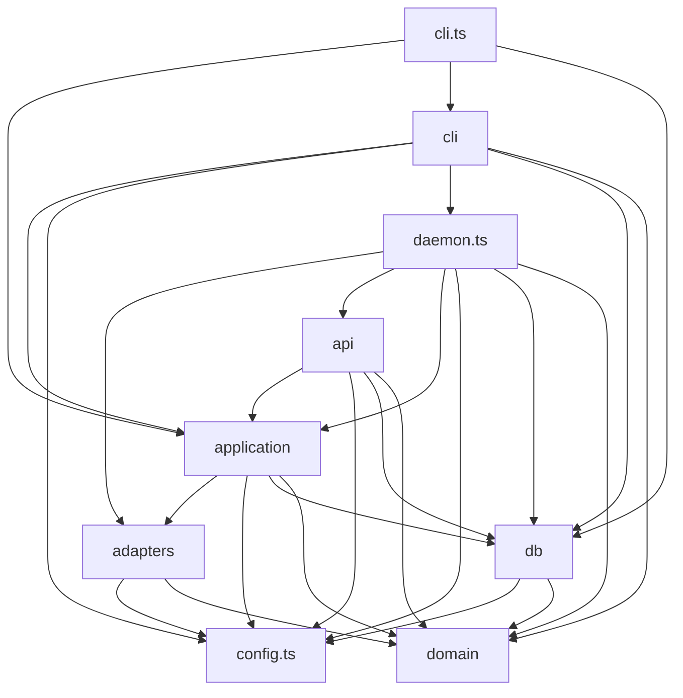
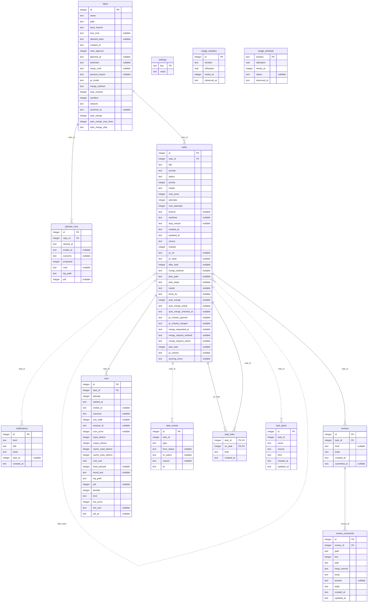
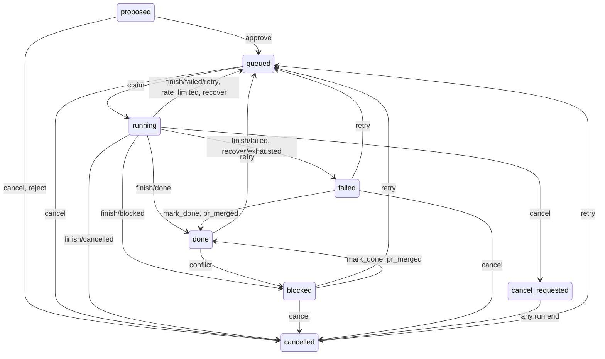

# Architecture

A map of AgentDeck's code. The blocks between `<!-- generated:NAME -->` and `<!-- /generated -->` are written by `pnpm docs:gen` from the code (Claude's edit hook runs it after each edit under `daemon/src`), and `pnpm test` fails when they are stale. The two sections written by hand are checked too: every file in `daemon/src/adapters/` must be named in the system context, and every identifier in backticks in them must be exported from `daemon/src`. The rules the layers follow are in CLAUDE.md.

## System context

## One task's run

`Scheduler` ticks, asks the governor (`decide`, behind `startGate`) whether new work may start, and claims the next queued task into a slot. `runTask` syncs the branch (`syncBranch`), runs claude through `runClaude`, then the repo's tests, and opens the pull request (`openPullRequest`). A repo with auto-merge on is merged by `autoMerge`; otherwise a person merges, and `refreshPrStates` finds the merged PR and moves the task on with the pr_merged event.

Plans live in the database, never in the repo: a plan belongs to the task it was first attached to and is named after it (`planFileName`, as in 112-plans-in-agentdeck.html), and other tasks follow it through their plan_task link. Before claude starts, `writePlanFile` writes the plan the task follows (`followedPlan`) to the worktree's plan file (`PLAN_FILE`), in a folder git ignores. After the run, whatever its outcome, `takePlanFile` reads it back and saves only the task's linked steps into the stored plan (`mergePlanSteps`), so sibling tasks on one plan can run at once; a task with no plan that wrote one gets it as its own. The PR body (`prPlanFor`) reads the stored plan.

The run stores claude's session id as soon as `runClaude` reads it off claude's first line. If the daemon restarts mid-run, the next daemon stops the orphaned claude (`reapOrphans`), ends the run as interrupted (`INTERRUPTED`) and requeues the task without using an attempt. The task's next run continues that session with `--resume`, a short prompt and the turns the attempt has left (`resumableSession`, `buildResumePrompt`, `resumeMaxTurns`), looking past a run a rate limit ended since; if claude says it no longer has the session (`resumeFailed`), `startTaskRun` starts a fresh claude in the same run. A task whose prompt or plan a person edited since the cut-off starts afresh instead (`editsSinceCutOff`), with a prompt that carries the last finished run's verdict and final message. Every run first gives back the plan file the last run left (`takePlanFile` is safe to repeat), so a cut-off run's step statuses survive whatever ends the task. After `MAX_RESTARTS` restarts the task fails instead.

## Layers

Which layers of `daemon/src` import which.

<!-- generated:layers -->

<!-- /generated -->

## Data model

Solid lines are foreign keys. Dotted lines are columns that name another row but have no foreign key.

<!-- generated:data-model -->

<!-- /generated -->

## Task lifecycle

<!-- generated:lifecycle -->

<!-- /generated -->

## HTTP API

<!-- generated:routes -->

| Method | Path                               | Use case                                                           |
| ------ | ---------------------------------- | ------------------------------------------------------------------ |
| GET    | `/api/daemon/health`               | `actions.daemonReport`                                             |
| POST   | `/api/daemon/restart-now`          | `actions.restartNow`                                               |
| POST   | `/api/daemon/restart`              | `actions.restartDaemon`                                            |
| GET    | `/api/daemon`                      | `actions.daemonState`                                              |
| GET    | `/api/events`                      |                                                                    |
| POST   | `/api/notify/test`                 | `actions.sendTestNotification`                                     |
| POST   | `/api/pause`                       | `actions.setPaused`, `actions.status`                              |
| POST   | `/api/repos/:id/archive`           | `actions.archiveRepo`                                              |
| GET    | `/api/repos/:id/deletion`          | `actions.repoDeletionPreview`                                      |
| POST   | `/api/repos/:id/doctor`            | `actions.doctorRepo`                                               |
| POST   | `/api/repos/:id/plan`              | `actions.proposeNow`                                               |
| POST   | `/api/repos/:id/resume`            | `actions.resumeRepo`                                               |
| POST   | `/api/repos/:id/unarchive`         | `actions.unarchiveRepo`                                            |
| DELETE | `/api/repos/:id`                   | `actions.deleteRepo`                                               |
| GET    | `/api/repos/:id`                   | `actions.repoDetail`                                               |
| POST   | `/api/repos/:id`                   | `actions.updateRepo`                                               |
| GET    | `/api/repos`                       | `db.listRepos`                                                     |
| POST   | `/api/repos`                       | `actions.addRepo`                                                  |
| POST   | `/api/resume`                      | `actions.setPaused`, `actions.status`                              |
| POST   | `/api/review-comments/:id/reopen`  | `actions.reopenReviewComment`                                      |
| POST   | `/api/review-comments/:id/resolve` | `actions.resolveReviewComment`                                     |
| DELETE | `/api/review-comments/:id`         | `actions.deleteReviewComment`                                      |
| POST   | `/api/reviews/:id/comments`        | `actions.addReviewComment`                                         |
| POST   | `/api/reviews/:id/submit`          | `actions.submitReview`                                             |
| POST   | `/api/reviews/:id`                 | `actions.editReview`                                               |
| GET    | `/api/service`                     | `actions.serviceStatus`                                            |
| GET    | `/api/settings`                    | `actions.getSettings`                                              |
| POST   | `/api/settings`                    | `actions.updateSettings`                                           |
| GET    | `/api/stats`                       | `actions.pilotStats`                                               |
| GET    | `/api/status`                      | `actions.status`                                                   |
| POST   | `/api/tasks/:id/approve`           | `actions.approveTask`, `actions.taskDetail`                        |
| POST   | `/api/tasks/:id/auto-merge`        | `actions.setAutoMerge`, `actions.taskDetail`                       |
| POST   | `/api/tasks/:id/cancel`            | `actions.cancelTask`                                               |
| GET    | `/api/tasks/:id/changes`           | `actions.taskChanges`                                              |
| POST   | `/api/tasks/:id/clean`             | `actions.removeTaskWorktree`, `actions.taskDetail`                 |
| POST   | `/api/tasks/:id/close-pr`          | `actions.closeTaskPr`, `actions.taskDetail`                        |
| GET    | `/api/tasks/:id/diff`              | `actions.taskDiff`                                                 |
| POST   | `/api/tasks/:id/done`              | `actions.markDone`, `actions.taskDetail`                           |
| GET    | `/api/tasks/:id/file`              | `actions.taskFile`                                                 |
| POST   | `/api/tasks/:id/fix-checks`        | `actions.fixChecks`, `actions.taskDetail`                          |
| POST   | `/api/tasks/:id/install-needs`     | `actions.installNeeds`, `actions.taskDetail`                       |
| DELETE | `/api/tasks/:id/links/:id2`        | `actions.unlinkTasks`, `actions.taskDetail`                        |
| POST   | `/api/tasks/:id/links`             | `actions.linkTasks`, `actions.taskDetail`                          |
| GET    | `/api/tasks/:id/log`               | `streamLog`                                                        |
| DELETE | `/api/tasks/:id/merge-request`     | `actions.cancelMergeRequest`, `actions.taskDetail`                 |
| POST   | `/api/tasks/:id/merge-request`     | `actions.requestMerge`, `actions.taskDetail`                       |
| GET    | `/api/tasks/:id/merge`             | `actions.mergePreview`                                             |
| POST   | `/api/tasks/:id/merge`             | `actions.mergeTask`, `actions.taskDetail`                          |
| GET    | `/api/tasks/:id/plans/:id2`        | `actions.planHtml`                                                 |
| POST   | `/api/tasks/:id/plans`             | `actions.attachPlan`                                               |
| POST   | `/api/tasks/:id/reject`            | `actions.rejectTask`, `actions.taskDetail`                         |
| POST   | `/api/tasks/:id/retry`             | `actions.retryTask`, `actions.taskDetail`                          |
| GET    | `/api/tasks/:id/reviews`           | `actions.taskReviews`                                              |
| POST   | `/api/tasks/:id/reviews`           | `actions.startReview`                                              |
| POST   | `/api/tasks/:id/sync`              | `actions.syncNow`, `actions.taskDetail`                            |
| GET    | `/api/tasks/:id/tree`              | `actions.taskTree`                                                 |
| GET    | `/api/tasks/:id`                   | `actions.taskDetail`                                               |
| POST   | `/api/tasks/:id`                   | `actions.editTask`, `actions.taskDetail`, `actions.promptWarnings` |
| POST   | `/api/tasks/merge-requests`        | `actions.requestMerges`                                            |
| GET    | `/api/tasks`                       | `actions.taskViews`                                                |
| POST   | `/api/tasks`                       | `actions.addTask`, `actions.taskDetail`, `actions.promptWarnings`  |

<!-- /generated -->

## Settings

<!-- generated:settings -->

| Setting                  | Default                                                         | Meaning                                                                                          |
| ------------------------ | --------------------------------------------------------------- | ------------------------------------------------------------------------------------------------ |
| `five_hour_max`          | `0.85`                                                          | Governor: no new work above this share of the 5-hour window                                      |
| `five_hour_soft`         | `0.6`                                                           | Governor: one task at a time above this share of the 5-hour window                               |
| `max_concurrent`         | `2`                                                             | Slots: how many tasks may run at once                                                            |
| `notify_desktop`         | `1`                                                             | Show desktop notifications                                                                       |
| `notify_events`          | `done,blocked,failed,hold,paused,proposed,merged,checks_failed` | The notification kinds to send, comma-separated                                                  |
| `ntfy_server`            | `https://ntfy.sh`                                               | The ntfy server                                                                                  |
| `ntfy_topic`             | (empty)                                                         | The ntfy topic to push notifications to; empty for none                                          |
| `pace_slack`             | `0.1`                                                           | Governor: how far ahead of the even weekly pace spending may run                                 |
| `paused`                 | `1`                                                             | The daemon starts no new work while this is 1; it starts paused until someone resumes it         |
| `planner_enabled`        | `1`                                                             | Let the planner propose tasks when a repo's queue runs dry                                       |
| `planner_interval_hours` | `3`                                                             | The fewest hours between two planner runs on a repo                                              |
| `planner_max_tasks`      | `3`                                                             | The most proposals one planner run keeps                                                         |
| `planner_model`          | `sonnet`                                                        | The model the planner runs with                                                                  |
| `pr_check_requested`     | `0`                                                             | Set to 1 to have the scheduler check open pull requests on its next tick                         |
| `rate_limited_until`     | `0`                                                             | Unix seconds until which a run that hit the usage limit keeps new work from starting; 0 for none |
| `reload_on_change`       | `0`                                                             | Restart the daemon onto new code when daemon/src changes and nothing is running                  |
| `weekly_max`             | `0.8`                                                           | Governor: the share of the 7-day window the weekly allowance grows to                            |

<!-- /generated -->

## Migrations

<!-- generated:migrations -->

| Step | What it does                                                                                                                                                                                                                              |
| ---- | ----------------------------------------------------------------------------------------------------------------------------------------------------------------------------------------------------------------------------------------- |
| 1    | baseline. Brings a database from any earlier (unversioned) release up to date; the column additions are idempotent because old databases may already have some of them.                                                                   |
| 2    | runsForTask runs on every task view and every 500 ms per open log stream.                                                                                                                                                                 |
| 3    | repo integration. toolchain is detected at `repo add`; setup_cmd runs in each new worktree.                                                                                                                                               |
| 4    | a repo can be paused (doctor failed, setup failed, permissions refused); runs count refused tool uses.                                                                                                                                    |
| 5    | pull requests and task dependencies. pr_mode is off \| draft \| ready; pr_state is open \| merged \| closed.                                                                                                                              |
| 6    | task history. One row per status change, written with the change itself (db/tasks.ts).                                                                                                                                                    |
| 7    | plans attached to a task (domain/plan). One row per plan name; the HTML is parsed on read.                                                                                                                                                |
| 8    | merging a PR from the app. merge_method is squash \| merge \| rebase: the repo's default, and the one a task was merged with.                                                                                                             |
| 9    | keeping task branches up to date with their base. A run is a work run or a resolve run (merging the base into the branch, which uses no attempt); auto_resolve lets the daemon start a resolve run on its own.                            |
| 10   | worker sandbox (docs/adr/0001-worker-sandbox.md). network is a JSON array of hosts sandboxed commands may reach.                                                                                                                          |
| 11   | a task can name the plan and steps it carries out (docs/plans/plan-linked-tasks.html). plan_path is repo-relative under docs/plans/; plan_steps is a JSON array of step ids, NULL for every unfinished step.                              |
| 12   | archiving a repo (docs/plans/repo-archive.html). archived_at is when it was archived, NULL while it is active.                                                                                                                            |
| 13   | what a blocked worker said it needs (docs/plans/fewer-blocks.html): JSON { kind, items }, NULL when nothing.                                                                                                                              |
| 14   | who said a task is done (docs/plans/manual-moves.html): 'person' when mark_done set it, NULL otherwise.                                                                                                                                   |
| 15   | the stop reason, named for the domain language (docs/plans/domain-model.html).                                                                                                                                                            |
| 16   | a paused repo notifies with its own kind, `paused`, instead of `hold`. Whoever listened for `hold` keeps hearing both.                                                                                                                    |
| 17   | auto-merge (docs/plans/auto-merge.html). auto_merge_skip is a JSON array of path prefixes that need a person; a task's auto_merge is NULL (its repo's), 0 or 1.                                                                           |
| 18   | task links (docs/plans/task-links.html). kind is builds_on \| after. after_task is copied in and no longer read.                                                                                                                          |
| 19   | the latest auto-merge check of a done task's open PR (docs/plans/auto-merge-view.html): JSON { verdict, reasons }, NULL when none; auto_merge_checked_at is when the PR refresh made it.                                                  |
| 20   | reviews made in the dashboard (docs/plans/review-merge.html). A review is a draft until submitted_at is set; kind is comment \| request_changes. A comment's state is open \| answered \| resolved; side is old \| new.                   |
| 21   | what a live run is doing: turns so far and the last tool call, kept from its stream while it runs.                                                                                                                                        |
| 22   | what the pilot scorecard needs and nothing kept. usage_samples is a history of usage readings, appended when a window's reading changes; pr_checks_opened / pr_checks_merged are JSON { total, failing, pending } of a PR's checks.       |
| 23   | merge requests (docs/plans/merge-requests.html). merge_requested_at is when a person asked the daemon to merge the task's PR once it is ready (NULL: no request); merge_request_check is the last check's JSON { verdict, reasons }.      |
| 24   | plans live in AgentDeck, named after the task they belong to. plan_task is the task whose plan this one follows (itself when its own plan was given with --plan); plan_steps names that plan's steps. plan_path is no longer written.     |
| 25   | when a run's pid was stored. Its claude started then, which can be minutes after the run row (setup, a sync), so crash recovery and the doctor tell our claude from a reused pid by this time, not by started_at.                         |
| 26   | an open PR's latest checks, one by one (domain/pull-request/checks.ts StoredChecks): JSON { read_at, head, checks, notified }, written by the PR refresh; notified says a person was told they fail. NULL until the PR's checks are read. |
| 27   | when a sync of the task's branch began (NULL when none is running). Syncs run in the daemon only, so the CLI reads this to see one; the daemon clears every marker on start.                                                              |

<!-- /generated -->
