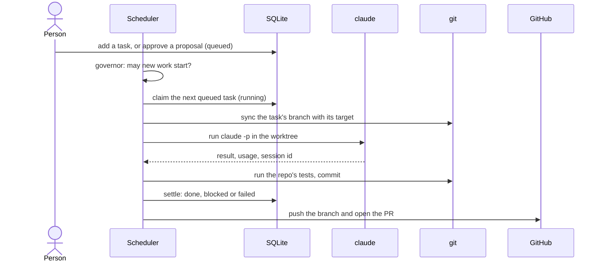
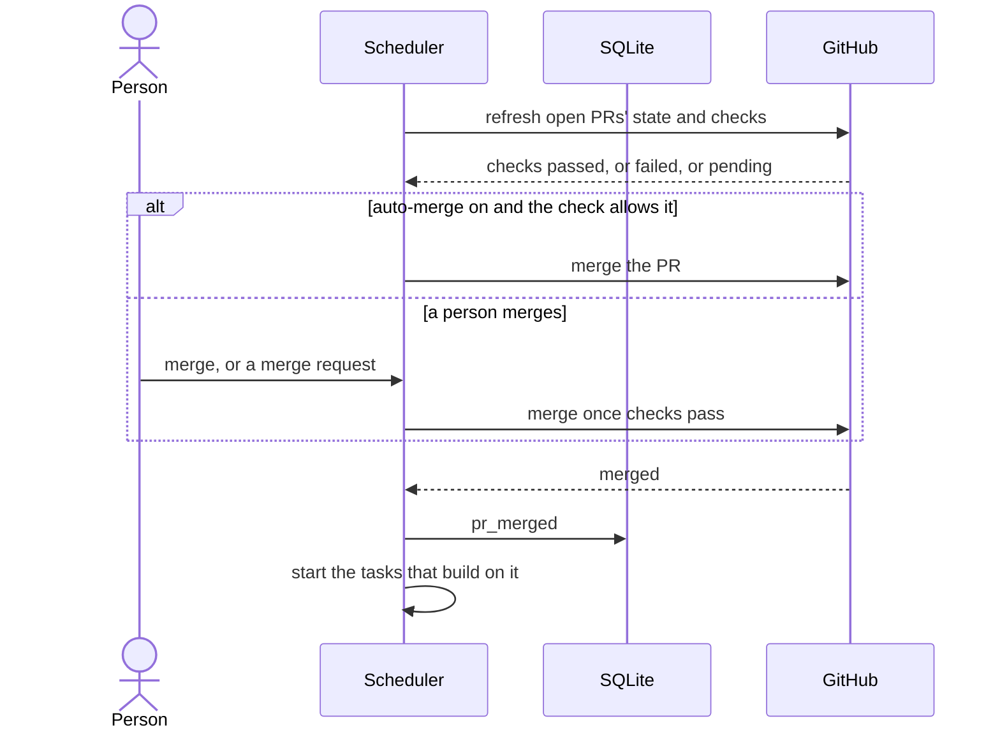
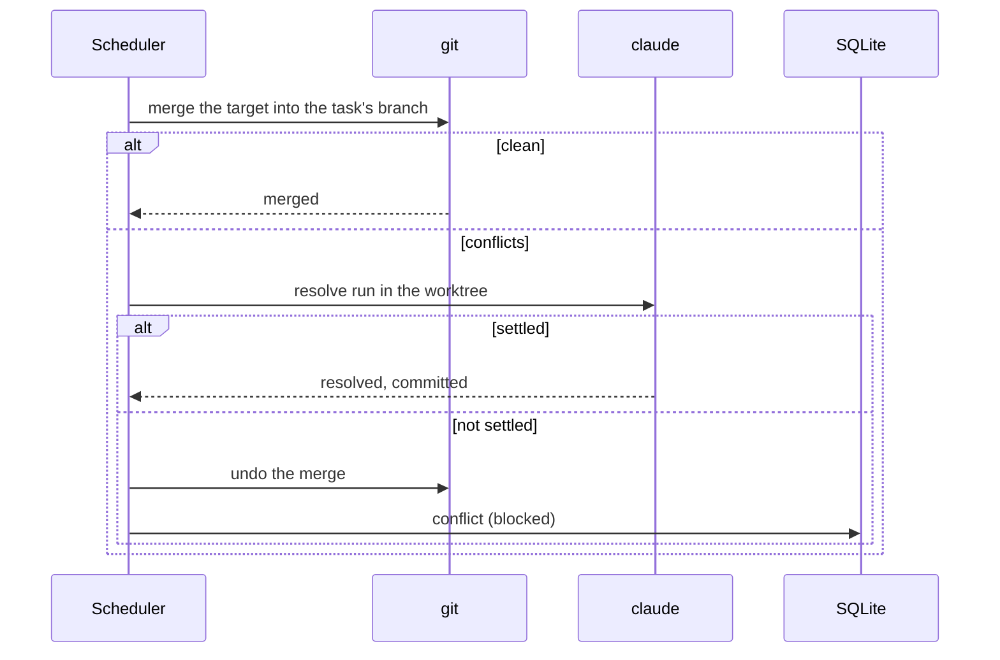
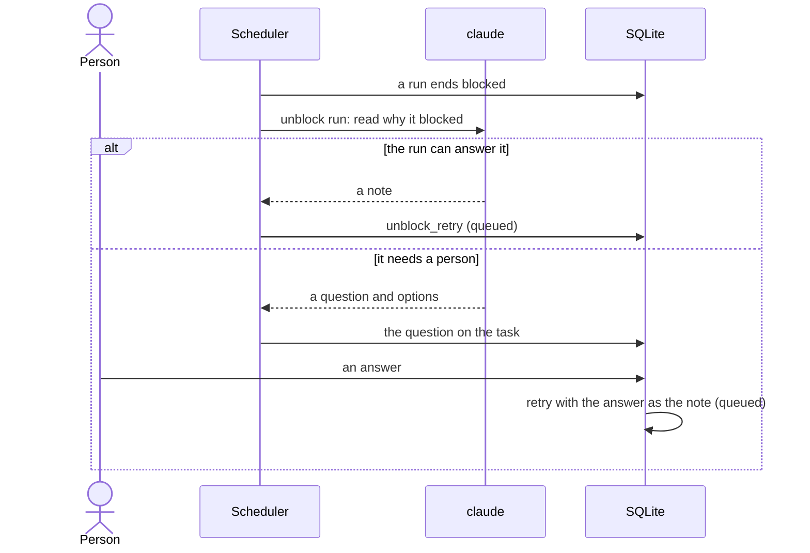
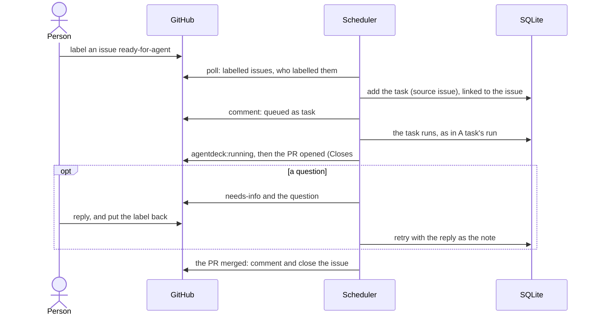
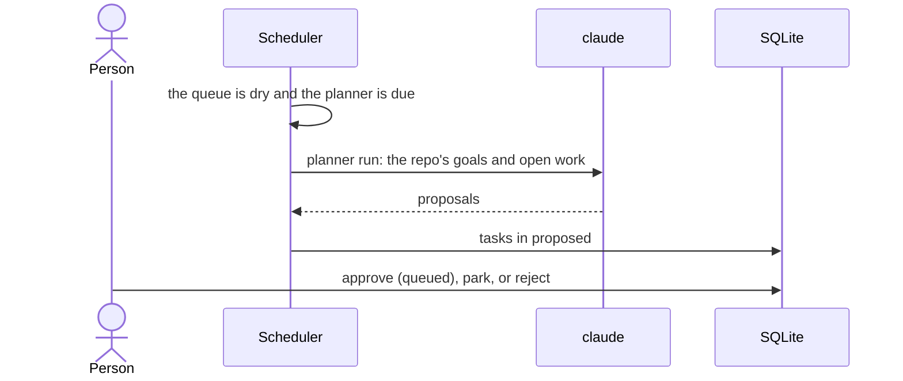
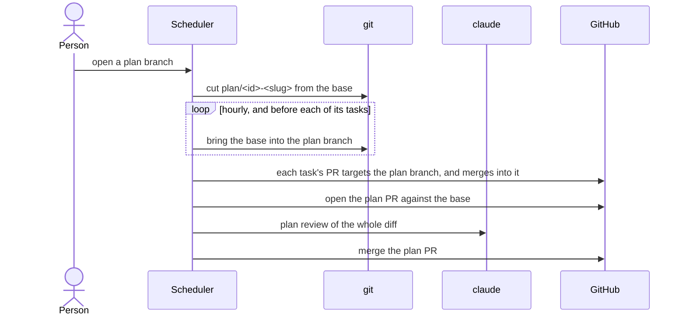
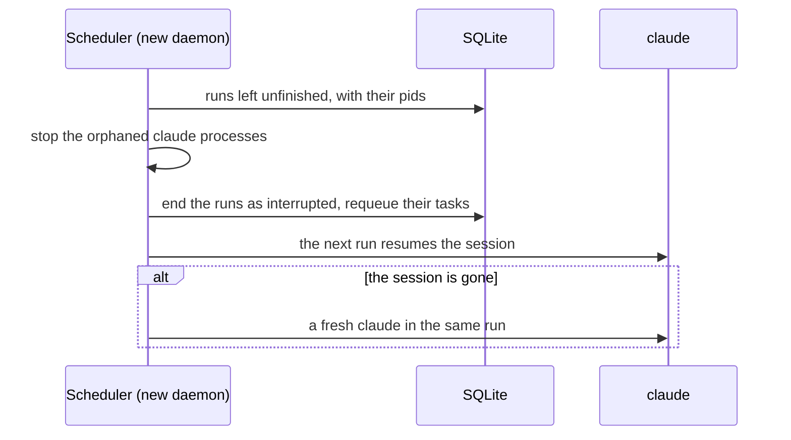

# Flows

How the parts of AgentDeck work together, one path through the system at a time: who starts it, what the daemon does on its ticks, and what it says to claude, git and GitHub. The map of the code is [architecture](architecture.md); the statuses and their events are in [state machines](reference/state-machines.md). Written by hand; `pnpm test` checks that every identifier in backticks is exported from `daemon/src`.

The actors in every diagram:

- **Person**: at the dashboard, the agentdeck CLI, or GitHub.
- **Scheduler**: the daemon's loop (`Scheduler`). Each tick it settles what ended, starts what may start, and runs the periodic chores.
- **SQLite**: the only state the processes share. The CLI writes it directly; the daemon reads it on its next tick.
- **claude**: `claude -p` in the task's worktree, one process group per run (`runClaude`).
- **git** and **GitHub**: local git in the repo and its worktrees, and `gh` for pull requests, checks and issues.

## A task's run

A person adds a task (`addTask`), or approves a proposal (`approveTask`), and it is queued. On a tick the governor (`decide`, behind `startGate`) says whether new work may start; if it may, the scheduler claims the next queued task into a slot and `runTask` runs it: sync, claude, the repo's tests. `settle` records how the run ended and runs its follow-ups, the highest of which opens the pull request (`openPullRequest`).

How a run's plan travels with it:

- Plans live in the database, never in the repo. A plan belongs to the task it was first attached to and is named after it (`planFileName`, as in 112-plans-in-agentdeck.html). Other tasks follow it through their plan_task link.
- Before claude starts, `writePlanFile` writes the plan the task follows (`followedPlan`) to the worktree's plan file (`PLAN_FILE`), in a folder git ignores.
- After the run, whatever its outcome, `takePlanFile` reads it back and saves only the task's linked steps into the stored plan (`mergePlanSteps`). That way, sibling tasks on one plan can run at once.
- A task with no plan that wrote one gets it as its own.
- The PR body (`prPlanFor`) reads the stored plan.

## Landing

A done task's pull request waits for its checks. With auto-merge on, the daemon judges it (`autoMergeCheck`) and merges it itself (`autoMerge`). Otherwise a person merges it from the dashboard (`mergeTask`), or asks for a merge (`requestMerge`) that the daemon carries out once the PR is ready. A PR merged on GitHub is found by `refreshPrStates` on a later tick, and the task moves on with the pr_merged event.

## A sync, and a resolve run

Before every run, and for a done task whose PR conflicts, `syncBranch` brings the target into the task's branch. A clean merge needs no claude. A merge with conflicts starts a resolve run (`resolveConflicting`), which uses no attempt. A conflict it can't settle is undone, and the task is blocked.

## A question

In a repo with auto_unblock on, a blocked task gets a short unblock run (`startUnblock`, `runUnblock`). The run either retries the task with a note, or leaves it blocked with a question and options for a person. The person answers in the dashboard, or on the task's issue in an issue-backed repo, and the task is retried with the answer as its note (`retryTask`).

## A task from a GitHub issue

In a repo with issues on, tasks come from GitHub Issues instead of `agentdeck add`.

- Every two minutes `pollIssues` reads the repo's open issues.
- An issue labelled ready-for-agent by an allowed login becomes a queued task (`issueIntake`). An issue blocked by another issue builds on that issue's task. A sub-issue's prompt carries its parent as context.
- On each poll after that, a person's change on the issue reaches the task (`issueMove`):
  - a removed label, or a close, cancels a queued task;
  - an edit to the issue edits the task;
  - the label put back on a blocked or failed task retries it, with the allowed logins' new comments as the note (`issueNote`).
- Each change to the task is told to the issue once (`dueIssueWrite`): queued, started, a question (labelled needs-info), stopped, the PR opened, and merged, which closes the issue.

### Open issues as proposals

- Every other open issue becomes a proposed task (`proposalIntake`), except one labelled ready-for-human or agentdeck:ignore, a parent of sub-issues, a plan, or one with an empty body. Nothing is said on the issue.
- A person approves, parks, lifts or rejects it in the dashboard as any proposal, and the issue hears it once: approved adds ready-for-agent, parked adds agentdeck:parked with the reason, lifted takes it off, and rejected closes the issue as not planned.
- On GitHub, the ready-for-agent label from an allowed login approves the proposal; on a parked one it is taken off with a comment to lift it first.
- An edit to the issue edits the proposal. Closing the issue, or a keep-out label, drops the proposal without a word and frees the issue, so reopened it is proposed again.
- A verify run's findings go on the issue as a comment once it ends (`dueVerifyComment`), so the record stays on GitHub; one with no findings, or that failed, puts nothing there.

### A parent issue as a plan

- A parent issue labelled agentdeck:plan by an allowed login becomes a plan (`planIntake`): its title is the plan's title, its body the plan's page (each Markdown heading a step), owned by a parked task linked to the issue. A plan branch `plan/<id>-<slug>` opens from the repo's base; the repo's base branch never changes.
- Its sub-issues labelled ready-for-agent become tasks that follow the plan and target its plan branch. One already queued and not started moves onto it when the parent gets the label.
- The plan branch is cut, kept current, reviewed and landed as any plan branch is: one plan PR into the base, with the plan review. Each sub-issue still closes when its own PR into the plan branch merges.
- The parent hears each step once (`duePlanIssueWrite`): opened as a plan, the plan PR opened, and merged, which closes it as completed with a link to the plan PR.
- The label taken off, or the parent closed, before the plan branch is cut abandons it (`abandonPlanBranch`), moves its tasks back to the base and cancels the parked task. A parent without the label is only context, as above.

## A proposal

When a repo's queue runs dry and its planner is due (`plannerDue`), the planner reads the repo's goals and proposes tasks (`propose`). They wait in proposed, on Attention, until a person approves them in the dashboard (`approveTask`), parks them, or rejects them.

## A plan branch

A person opens a plan branch for a plan in a repo (`openPlanBranch`), and the plan's tasks target it.

- The daemon cuts it from the base when its first task starts (`cutPlanBranch`).
- It keeps the branch current with the base, hourly and before each of its tasks starts (`keepPlanBranchCurrent`, `syncPlanBranch`).
- When the plan's tasks are merged into it, the daemon opens the plan PR (`openPlanBranchPr`). A plan review reads the whole diff against the plan's steps (`runPlanReview`).
- The plan branch lands on the base as one pull request (`landPlanBranches`).

## A crash, and resuming a run

A run stores claude's session id as soon as `runClaude` reads it off claude's first line.

- If the daemon restarts mid-run, the next daemon stops the orphaned claude (`reapOrphans`), ends the run as interrupted (`INTERRUPTED`), and requeues the task without using an attempt.
- The task's next run continues that session with `--resume`, a short prompt, and the turns the attempt has left (`resumableSession`, `buildResumePrompt`, `resumeMaxTurns`). It looks past any run a rate limit ended since.
- If claude says it no longer has the session (`resumeFailed`), `startTaskRun` starts a fresh claude in the same run.
- A task whose prompt or plan a person edited since the cut-off starts afresh instead (`editsSinceCutOff`). Its prompt carries the last finished run's verdict and final message.
- Every run first gives back the plan file the last run left (`takePlanFile` is safe to repeat), so a cut-off run's step statuses survive whatever ends the task.
- After `MAX_RESTARTS` restarts, the task fails instead.

