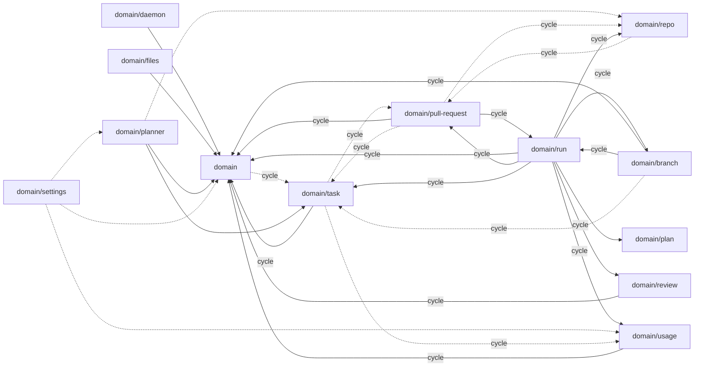

# Context map

<!-- Generated by `pnpm docs:gen` from the code. Do not edit: `pnpm test` fails when it is stale. -->

The folders under `domain/` and the imports between them. A solid arrow is a runtime import, a dotted one is type-only; an edge inside a cycle is labelled `cycle`.

Cycles:

- `domain` ↔ `domain/branch` ↔ `domain/pull-request` ↔ `domain/repo` ↔ `domain/review` ↔ `domain/run` ↔ `domain/task` ↔ `domain/usage`
