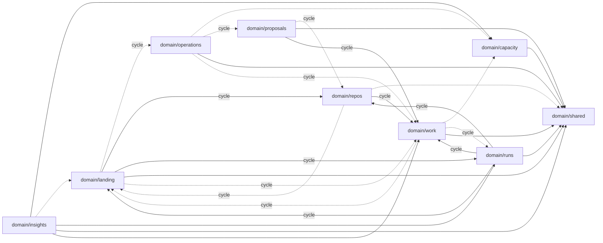

# Context map

<!-- Generated by `pnpm docs:gen` from the code. Do not edit: `pnpm test` fails when it is stale. -->

The folders under `domain/` and the imports between them. A solid arrow is a runtime import, a dotted one is type-only; an edge inside a cycle is labelled `cycle`.

Cycles:

- `domain/landing` ↔ `domain/operations` ↔ `domain/proposals` ↔ `domain/repos` ↔ `domain/runs` ↔ `domain/work`
