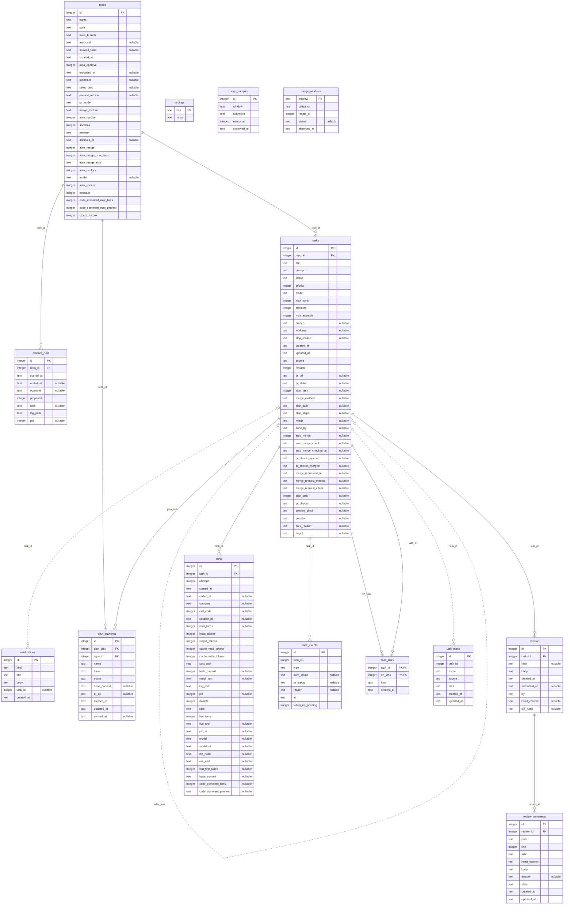

# Data model

<!-- Generated by `pnpm docs:gen` from the code. Do not edit: `pnpm test` fails when it is stale. -->

Solid lines are foreign keys. Dotted lines are columns that name another row but have no foreign key.

