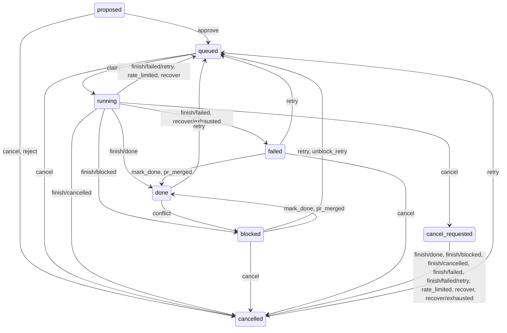
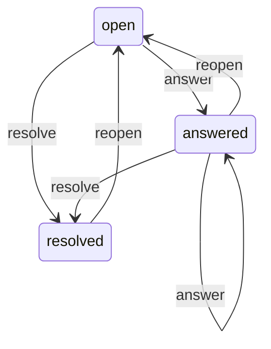

# State machines

<!-- Generated by `pnpm docs:gen` from the code. Do not edit: `pnpm test` fails when it is stale. -->

Each state machine of `domain/`, read from its rule table.

## Task lifecycle

The rule table is `RULES` in `domain/work/lifecycle.ts`. States: `proposed`, `queued`, `running`, `done`, `blocked`, `failed`, `cancel_requested`, `cancelled`.

| Event                 | Moves                                                                                                         |
| --------------------- | ------------------------------------------------------------------------------------------------------------- |
| `claim`               | queued → running                                                                                              |
| `finish:done`         | running → done, cancel_requested → cancelled                                                                  |
| `finish:blocked`      | running → blocked, cancel_requested → cancelled                                                               |
| `finish:cancelled`    | running → cancelled, cancel_requested → cancelled                                                             |
| `finish:failed`       | running → failed, cancel_requested → cancelled                                                                |
| `finish:failed:retry` | running → queued, cancel_requested → cancelled                                                                |
| `rate_limited`        | running → queued, cancel_requested → cancelled                                                                |
| `conflict`            | done → blocked                                                                                                |
| `cancel`              | proposed → cancelled, queued → cancelled, blocked → cancelled, failed → cancelled, running → cancel_requested |
| `approve`             | proposed → queued                                                                                             |
| `reject`              | proposed → cancelled                                                                                          |
| `retry`               | blocked → queued, failed → queued, cancelled → queued, done → queued                                          |
| `unblock_retry`       | blocked → queued                                                                                              |
| `mark_done`           | blocked → done, failed → done                                                                                 |
| `pr_merged`           | blocked → done, failed → done                                                                                 |
| `recover`             | running → queued, cancel_requested → cancelled                                                                |
| `recover:exhausted`   | running → failed, cancel_requested → cancelled                                                                |

## Review comment

The rule table is `COMMENT_MOVES` in `domain/landing/review.ts`. States: `open`, `answered`, `resolved`.

| Action    | Moves                                |
| --------- | ------------------------------------ |
| `answer`  | open → answered, answered → answered |
| `resolve` | open → resolved, answered → resolved |
| `reopen`  | answered → open, resolved → open     |

## Not yet tables

State types in `domain/` that no rule table drives, and why.

| State type         | Why                                                                                                                      |
| ------------------ | ------------------------------------------------------------------------------------------------------------------------ |
| `AutoMergeState`   | a verdict computed from the pull request each time, not a state with moves                                               |
| `ChangeStatus`     | a git file change letter, read from git                                                                                  |
| `CheckState`       | a value read from GitHub for each check, not a state a thing moves through                                               |
| `HeadlineState`    | computed from the daemon and queue each time, not a state with moves                                                     |
| `LinkState`        | computed from the linked task each time, not a state with moves                                                          |
| `MergeRequestView` | a merge request is set, cleared and read as columns (domain/landing/merge-request.ts), not a state type with a table yet |
| `PlanStepStatus`   | set from the plan page by a person or worker; any step may take any status                                               |
| `PrState`          | a pull request moves by what GitHub reports (domain/landing/pr.ts), not by an event table yet                            |
| `StartState`       | computed from a task's links each time, not a state with moves                                                           |
