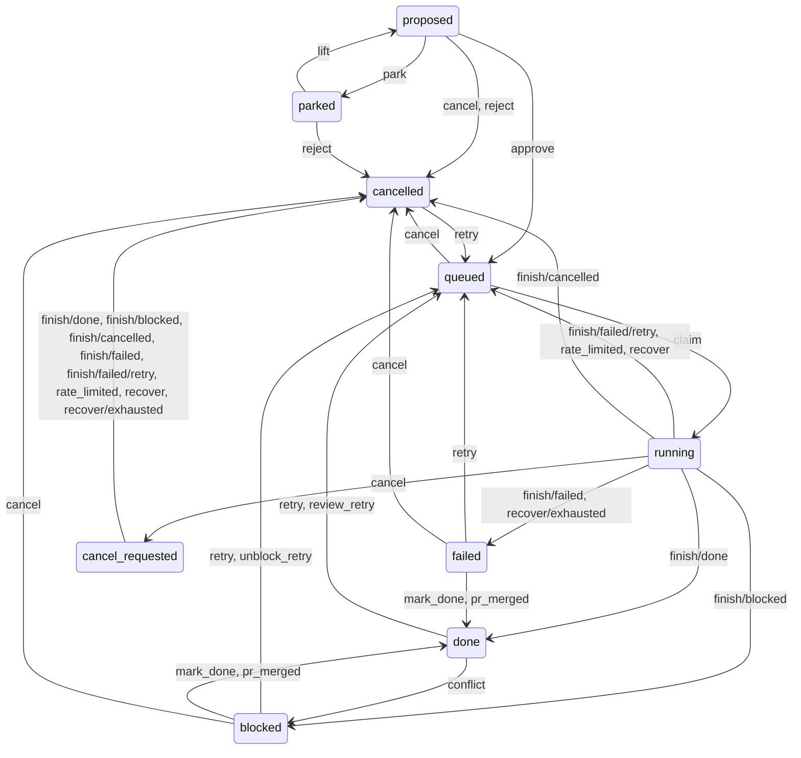
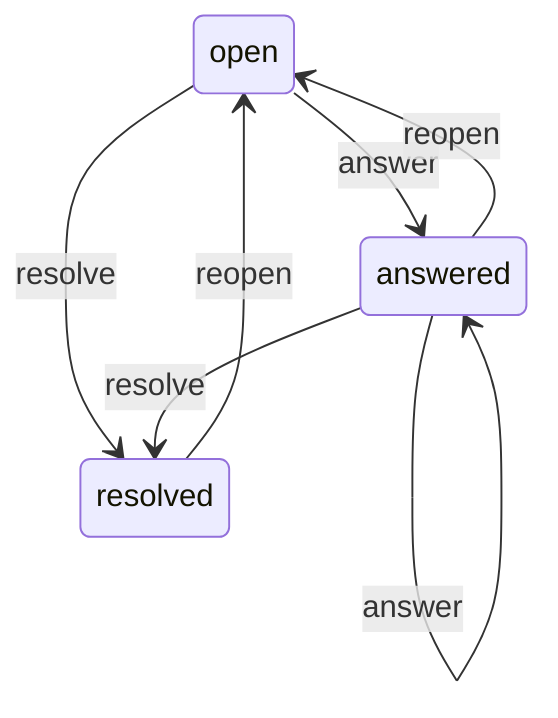
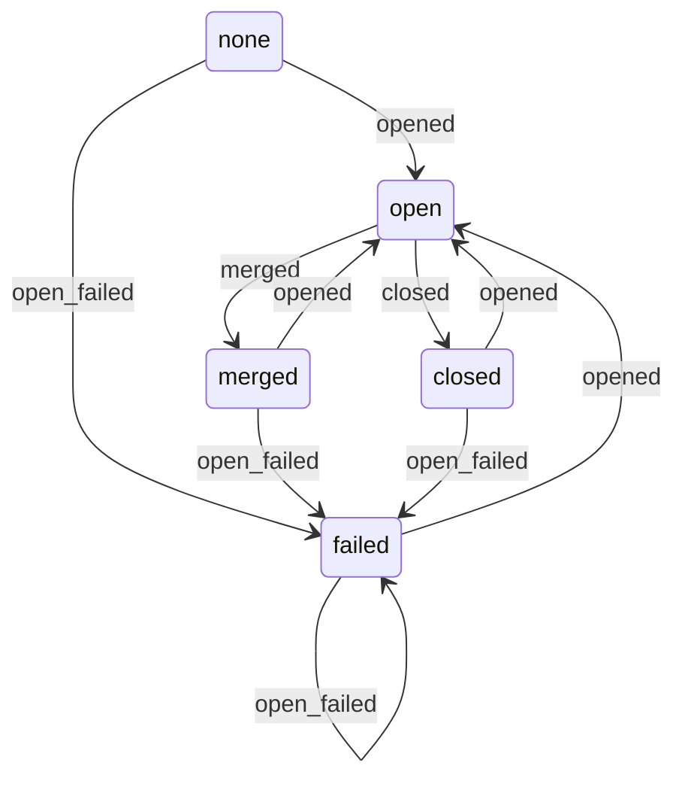
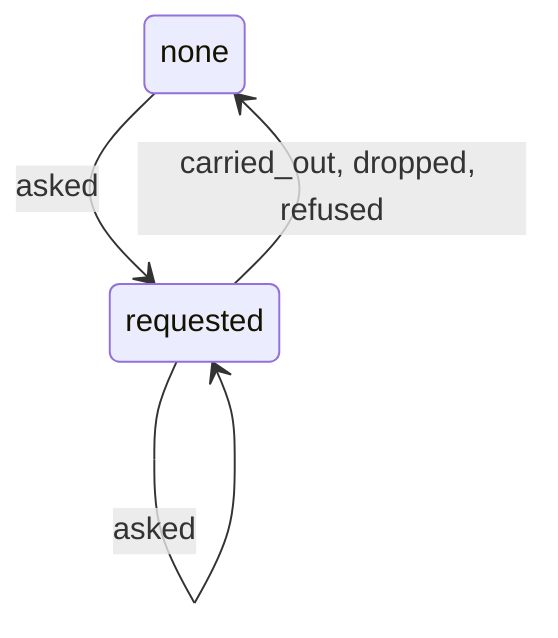
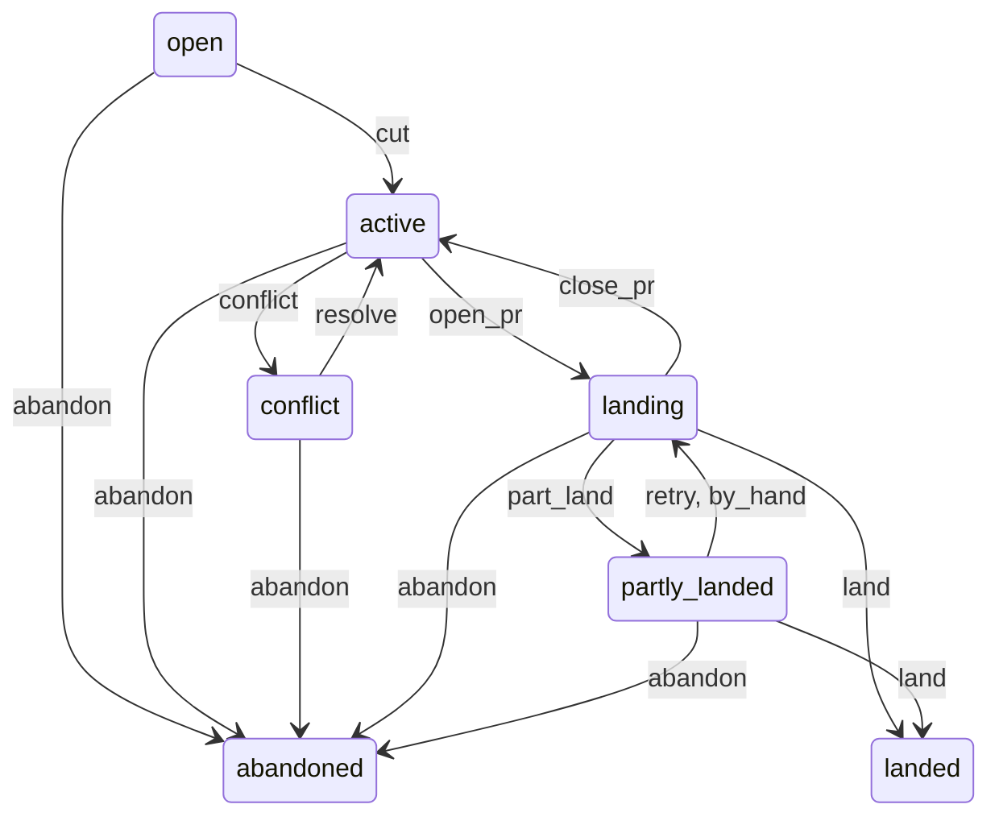

# State machines

<!-- Generated by `pnpm docs:gen` from the code. Do not edit: `pnpm test` fails when it is stale. -->

Each state machine of `domain/`, read from its rule table.

## Task lifecycle

The rule table is `RULES` in `domain/work/lifecycle/lifecycle.ts`. States: `proposed`, `parked`, `queued`, `running`, `done`, `blocked`, `failed`, `cancel_requested`, `cancelled`.

| Event                 | Moves                                                                                                         |
| --------------------- | ------------------------------------------------------------------------------------------------------------- |
| `claim`               | queued → running                                                                                              |
| `finish:done`         | running → done, cancel_requested → cancelled                                                                  |
| `finish:blocked`      | running → blocked, cancel_requested → cancelled                                                               |
| `finish:cancelled`    | running → cancelled, cancel_requested → cancelled                                                             |
| `finish:failed`       | running → failed, cancel_requested → cancelled                                                                |
| `finish:failed:retry` | running → queued, cancel_requested → cancelled                                                                |
| `rate_limited`        | running → queued, cancel_requested → cancelled                                                                |
| `conflict`            | done → blocked                                                                                                |
| `cancel`              | proposed → cancelled, queued → cancelled, blocked → cancelled, failed → cancelled, running → cancel_requested |
| `approve`             | proposed → queued                                                                                             |
| `reject`              | proposed → cancelled, parked → cancelled                                                                      |
| `park`                | proposed → parked                                                                                             |
| `lift`                | parked → proposed                                                                                             |
| `retry`               | blocked → queued, failed → queued, cancelled → queued, done → queued                                          |
| `unblock_retry`       | blocked → queued                                                                                              |
| `review_retry`        | done → queued                                                                                                 |
| `mark_done`           | blocked → done, failed → done                                                                                 |
| `pr_merged`           | blocked → done, failed → done                                                                                 |
| `recover`             | running → queued, cancel_requested → cancelled                                                                |
| `recover:exhausted`   | running → failed, cancel_requested → cancelled                                                                |

## Review comment

The rule table is `COMMENT_MOVES` in `domain/landing/review/review.ts`. States: `open`, `answered`, `resolved`.

| Action    | Moves                                |
| --------- | ------------------------------------ |
| `answer`  | open → answered, answered → answered |
| `resolve` | open → resolved, answered → resolved |
| `reopen`  | answered → open, resolved → open     |

## Pull request

The rule table is `PR_MOVES` in `domain/landing/pull-request/pr-moves.ts`. States: `none`, `open`, `merged`, `closed`, `failed`.

| Move          | Moves                                                            |
| ------------- | ---------------------------------------------------------------- |
| `opened`      | none → open, merged → open, closed → open, failed → open         |
| `merged`      | open → merged                                                    |
| `closed`      | open → closed                                                    |
| `reopened`    | none: ignored from every state                                   |
| `open_failed` | none → failed, merged → failed, closed → failed, failed → failed |

## Merge request

The rule table is `MERGE_REQUEST_MOVES` in `domain/landing/merge/merge-request.ts`. States: `none`, `requested`.

| Move          | Moves                                   |
| ------------- | --------------------------------------- |
| `asked`       | none → requested, requested → requested |
| `carried_out` | requested → none                        |
| `dropped`     | requested → none                        |
| `refused`     | requested → none                        |

## Plan branch

The rule table is `PLAN_BRANCH_MOVES` in `domain/work/plans/plan-branch.ts`. States: `open`, `active`, `conflict`, `landing`, `landed`, `abandoned`, `partly_landed`.

| Move        | Moves                                                                                                      |
| ----------- | ---------------------------------------------------------------------------------------------------------- |
| `cut`       | open → active                                                                                              |
| `conflict`  | active → conflict                                                                                          |
| `resolve`   | conflict → active                                                                                          |
| `open_pr`   | active → landing                                                                                           |
| `close_pr`  | landing → active                                                                                           |
| `land`      | landing → landed, partly_landed → landed                                                                   |
| `part_land` | landing → partly_landed                                                                                    |
| `retry`     | partly_landed → landing                                                                                    |
| `by_hand`   | partly_landed → landing                                                                                    |
| `abandon`   | open → abandoned, active → abandoned, conflict → abandoned, landing → abandoned, partly_landed → abandoned |

## Follow-ups

What the daemon does after a task's status changes: each domain event `transition` makes, the moves that make it (event, from which statuses) and its follow-ups. The table is `FOLLOW_UPS` in `domain/work/lifecycle/follow-ups.ts`, run by `application/landing/settle.ts`. `task_events` is the outbox: a change whose event has follow-ups writes its row pending in the same transaction, `settle` runs the daemon's at once and marks the row, and the daemon's tick runs whatever is still pending: a person's events (only the daemon follows up), crash recovery's, and any a crash cut off.

| Domain event          | Made by                                                                                                                                                                                                                                                                                                                                                                                 | Follow-ups                             |
| --------------------- | --------------------------------------------------------------------------------------------------------------------------------------------------------------------------------------------------------------------------------------------------------------------------------------------------------------------------------------------------------------------------------------- | -------------------------------------- |
| `TaskStarted`         | `claim` (queued)                                                                                                                                                                                                                                                                                                                                                                        | none                                   |
| `TaskQueued`          | `finish:failed:retry` (running), `rate_limited` (running), `approve` (proposed), `retry` (blocked, failed, cancelled, done), `unblock_retry` (blocked), `review_retry` (done), `recover` (running)                                                                                                                                                                                      | none                                   |
| `TaskFinished`        | `finish:done` (running)                                                                                                                                                                                                                                                                                                                                                                 | `open_pr`, `warn_dependents`, `notify` |
| `TaskPrMerged`        | `pr_merged` (blocked, failed)                                                                                                                                                                                                                                                                                                                                                           | `notify`                               |
| `TaskPrClosed`        |                                                                                                                                                                                                                                                                                                                                                                                         | `warn_dependents`                      |
| `TaskMarkedDone`      | `mark_done` (blocked, failed)                                                                                                                                                                                                                                                                                                                                                           | none                                   |
| `TaskBlocked`         | `finish:blocked` (running), `conflict` (done)                                                                                                                                                                                                                                                                                                                                           | `warn_dependents`, `notify`            |
| `TaskFailed`          | `finish:failed` (running), `recover:exhausted` (running)                                                                                                                                                                                                                                                                                                                                | `warn_dependents`, `notify`            |
| `TaskCancelRequested` | `cancel` (running)                                                                                                                                                                                                                                                                                                                                                                      | none                                   |
| `TaskCancelled`       | `finish:done` (cancel_requested), `finish:blocked` (cancel_requested), `finish:cancelled` (running, cancel_requested), `finish:failed` (cancel_requested), `finish:failed:retry` (cancel_requested), `rate_limited` (cancel_requested), `cancel` (proposed, queued, blocked, failed), `reject` (proposed, parked), `recover` (cancel_requested), `recover:exhausted` (cancel_requested) | `warn_dependents`                      |
| `TaskParked`          | `park` (proposed)                                                                                                                                                                                                                                                                                                                                                                       | none                                   |
| `TaskLifted`          | `lift` (parked)                                                                                                                                                                                                                                                                                                                                                                         | none                                   |

## Not yet tables

State types in `domain/` that no rule table drives, and why.

| State type       | Why                                                                                                                                                                                                            |
| ---------------- | -------------------------------------------------------------------------------------------------------------------------------------------------------------------------------------------------------------- |
| `AutoMergeState` | a verdict computed from the pull request each time (in a repo with auto_review on, with the review run of its changes: it waits for one, and needs a person when it asked for changes), not a state with moves |
| `ChangeStatus`   | a git file change letter, read from git                                                                                                                                                                        |
| `CheckState`     | a value read from GitHub for each check, not a state a thing moves through                                                                                                                                     |
| `HeadlineState`  | computed from the daemon and queue each time, not a state with moves                                                                                                                                           |
| `LinkState`      | computed from the linked task each time, not a state with moves                                                                                                                                                |
| `PlanStepStatus` | set from the plan page by a person or worker; any step may take any status                                                                                                                                     |
| `StartState`     | computed from a task's links each time, not a state with moves                                                                                                                                                 |
